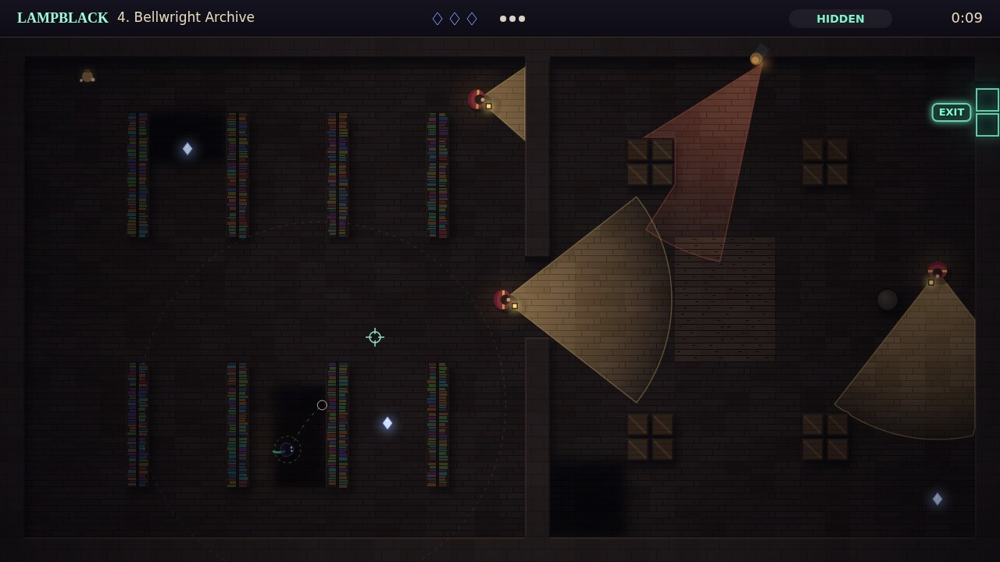

# Lampblack

[](https://make.fun/bounty/best-stealth-game-20261121-1759)
[](https://make.fun/bounty/best-stealth-game-20261121-1759)
[](https://make.fun/bounty/best-stealth-game-20261121-1759)

A top-down stealth game. You play Soot, a small thief in the Lantern Keep. The lampwardens carry their light wherever they look, and the light is the only thing that can catch you. Stay behind crates, shelves, hedges and walls, hide in shadow, toss pebbles to lure wardens away, and get out through the gate unseen.



- **Five levels:** The Gatehouse, Salt Cellars, The Moon Garden, Bellwright Archive and The Lantern Vault.
- **Wardens** patrol, turn to look around, go to check noises, search where they last saw you and grow suspicious before they catch you. Their vision cones are cut by every wall and crate.
- **Watching eyes** are wall lamps that sweep a beam back and forth and call the nearest warden when they spot you.
- **Stealth tools:** shadows hide you, sneaking is silent, gravel and creaky boards are loud, and pebbles make noise where they land.
- **Three stars per level:** escape, collect every moonstone, and never be suspected. Your progress and best times are saved in the browser.
- All art is drawn on a canvas in code and all sound and music is made with Web Audio, so there are no image or audio files and no network requests.

## Controls

| Input | Action |
| --- | --- |
| WASD / arrow keys | Move |
| Hold SHIFT | Sneak: slower but silent |
| Mouse + left click | Aim and throw a pebble |
| P / Esc | Pause |
| R | Restart the level |
| M | Mute |

## Run it

No build step. Open `game/index.html` in desktop Chrome, or serve it locally with Node 22:

```sh
node serve.ts          # http://localhost:8080
```

To make the screenshots again (headless Chrome, real renders of `?shot=` scenes listed in `shots.json`):

```sh
node shoot.ts /path/to/chrome
```

To build the bounty dossier:

```sh
mkdir -p out && MAKEFUN_OUTPUT_DIR=out node main.ts
```

---

Made for [make.fun](https://make.fun/?ref=vbrytm16).
